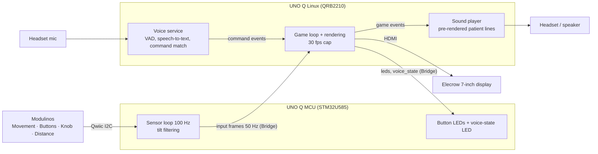
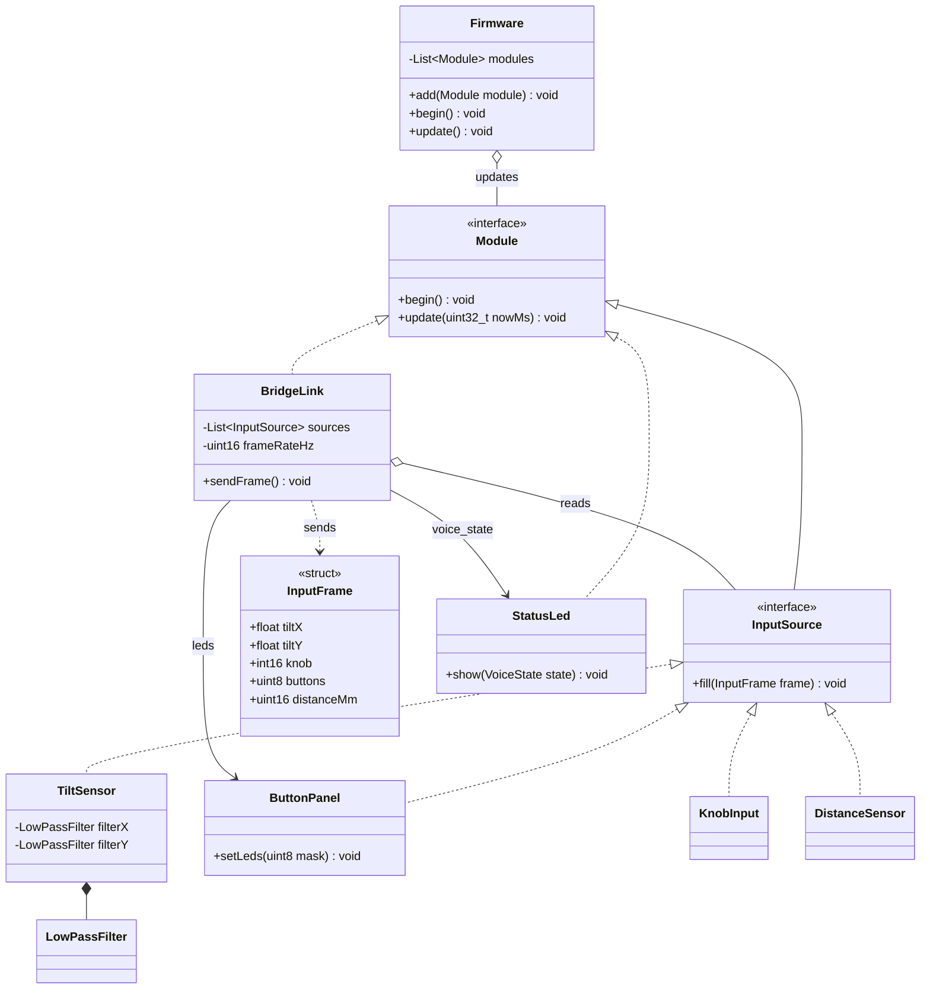
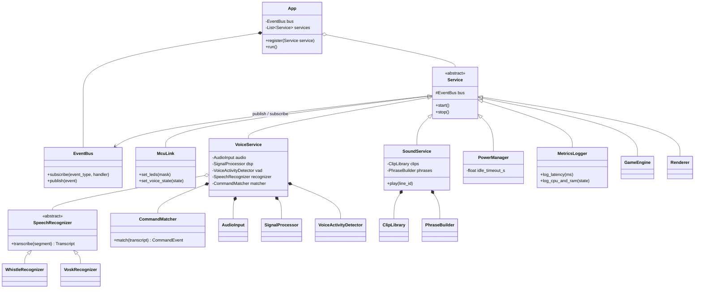
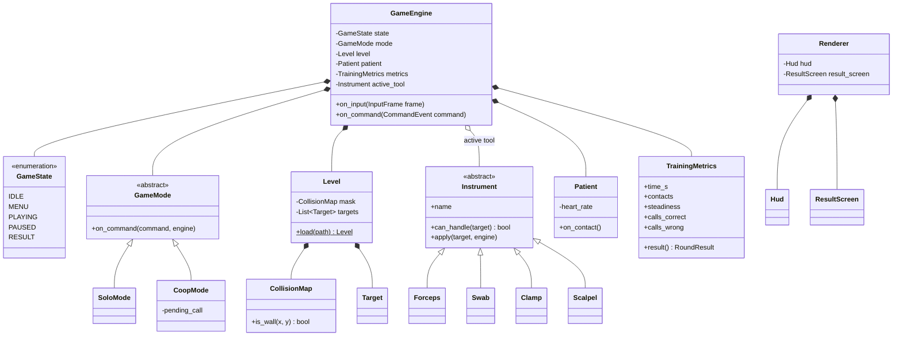

# Plan: Steady Hands (working title)

Draft of 13 November 2026, from our team discussion. ✅ marks a decision; ❓ marks a question still open. Wiring is in [WIRING.md](WIRING.md).

## The idea in one sentence

A working prototype of a surgeon trainer: you guide a surgical instrument through a patient map on a 7-inch screen by tilting the instrument in your hand, and you call for instruments by voice, as in a real operating room. The trainer measures how steady and precise you are. Everything runs offline on the Arduino UNO Q.

> The trainer is inspired by the steady-hand game Dr. Bibber (in English: Operation). We use our own name, patient, and artwork, so we can publish the build and demo it publicly.

## Why it is worth building

- **It trains what surgery needs:** steady hands, knowing the instrument names, and calling for instruments clearly while both hands are busy.
- **It trains the team, not just the hands.** In co-op mode, the surgeon calls for an instrument and the assistant repeats it back before the instrument is handed over. Operating-room teams confirm instructions out loud the same way (closed-loop communication), so the two only succeed if they talk to each other.
- **It gives measurable feedback.** After each round, the trainer shows time, wall contacts, steadiness, and instrument calls, so trainees can see their progress (see [Training feedback](#training-feedback)).
- **It is cheap, offline, and private.** It uses off-the-shelf parts and needs no internet or cloud, and it stores no audio. Training centres and medical schools with small budgets or poor connectivity can build and use it.
- **It is energy-aware.** Speech recognition runs only while a round is in progress and someone is speaking, and we measure the energy used (see [Energy and environment](#energy-and-environment)).
- ✅ **Target group and situation:** medical students and operating-room trainees during a practice session in a skills lab. This is a prototype, and we claim no proven training effect.
- **Why offline and privacy matter to them:** a trainee's voice recordings are personal data. The trainer needs no cloud account, no network access, and no handling of recordings, which makes it easier to use in hospitals and universities with strict IT and data-protection rules.

**Pitch sentence**, using the template from the hackathon README:

> For **medical students in a skills-lab practice session**, we help them **train steady hands and clear instrument calls** through speech, because **in surgery both hands are busy and instruments are requested by voice**, while keeping **their voices on the device**.

## Decisions

| Topic | Decision |
| --- | --- |
| ✅ Language | English |
| ✅ Players | One-player surgeon mode; two-player co-op as an extra mode |
| ✅ Listening | The mic listens all the time while a round runs, and is off in menus and idle |
| ✅ Where speech runs | On the UNO Q's Linux side; the Nicla Voice is dropped |
| ✅ Audio | Headset |
| ✅ Display | Elecrow 7" IPS, HDMI, 1024×600 |
| ✅ Energy measurement | PeakTech digital multimeter (see [WIRING.md](WIRING.md#energy-measurement-with-the-peaktech)) |
| ✅ D1 Toolchain | PlatformIO for the MCU sketch, plus a standalone Python app on the Linux side (see [D1](#d1-toolchain-platformio)) |
| ✅ Code style | Object-oriented and modular: every feature is a class behind an interface (see [Code design](#code-design)) |
| ❓ D2 Speech-to-text | Timon decides (model deployment and ASR choice are his area). The code ships `VoskRecognizer` (Vosk small English, vocabulary restricted to our commands: aarch64 wheel, 40 MB model) as the working default; any other engine is a further `SpeechRecognizer` subclass selected in the config (see [Speech pipeline](#speech-pipeline)) |
| ✅ Purpose | Working prototype of a surgeon trainer, inspired by Dr. Bibber |
| ✅ Wall feedback | A wall touch plays a buzz in the game (`SoundService`), then the patient's "Ouch!". |
| ❓ D3 Name | "Steady Hands" is a placeholder |
| ❓ D4 Audio for the audience | Headset audio only reaches the person wearing it. Does the display have an audio jack, or can we get a USB speaker? |
| ❓ D5 License for our code | Must fit the licenses of the models we use (see [Licenses](#licenses)) |
| ❓ D6 Publishing | Make this repo public at the end, or publish a public copy (see [Publishing](#publishing)) |

## Gameplay

### One-player mode

The surgeon holds the **instrument**, a handle containing the Modulino Movement, and tilts it to steer the tool tip through the corridors of the patient map. The surgeon wears the headset and calls for tools. Touching a wall plays a buzz in the game, makes the patient react ("Ouch!"), and raises the patient's heart rate. After three touches, the patient wakes up and the round is lost. Removing every item before time runs out wins. A round lasts about 60 seconds, so a trainee gets feedback within the first minute.

### Co-op mode (two players)

- The **surgeon** steers and calls for instruments out loud ("Clamp!").
- The **assistant** wears the headset and repeats each call back ("Clamp."). The game hands the instrument over when it hears the call-back. Operating-room teams use this closed-loop confirmation too.
- The assistant also runs the room by voice: switching on the light, and calling "steady" for precision mode.

### Controls

| Input | Action |
| --- | --- |
| Modulino Movement (in the instrument) | Tilt moves the tool tip |
| Modulino Knob | Menu: picks the level · Round: turn picks the instrument, press switches on the light in dark zones · Paused: steering sensitivity |
| Modulino Buttons A / B / C | A: start, use the instrument · B: pause/continue · C: next instrument in a round; in the menu, switch between one-player and co-op |
| Modulino Distance (optional, stretch) | Hand height sets depth: lower your hand to grab, raise it to travel |
| Voice | Tool and room commands (see below) |

### Voice commands

We picked words that sound different from each other. Every recognised command is shown on screen so the player sees what the game heard.

| Command | Effect |
| --- | --- |
| `forceps` | Grab tool: picks up items |
| `swab` | Clears blood that blocks a corridor |
| `clamp` | Stops a bleeding timer |
| `scalpel` | Opens a sealed passage (stretch) |
| `light` | Lights up a dark part of the map for a few seconds (co-op) |
| `steady` | Precision mode for a few seconds: slower, finer movement |
| `cancel` | Undoes the last tool change, or closes the menu |
| `repeat` | The patient repeats their last line |
| `help` | The patient lists the commands that work right now |
| `pause` · `continue` · `new game` | Game flow |

### Levels

Each level is a PNG mask with a small JSON file:
- the mask has black walls, white corridors, and coloured item spots,
- the JSON holds the start point, the items, and the tool each item needs.

Collision detection is a pixel lookup in the mask, so anyone on the team can draw levels. Target: three levels for the demo.

### Training feedback

After each round, the screen shows:

| Metric | How we measure it |
| --- | --- |
| Time | From the start of the round until the last item is out |
| Wall contacts | Number of collisions |
| Steadiness | Jitter in the filtered tilt signal while moving through corridors |
| Instrument calls | Correct calls, and calls for the wrong instrument for the task |
| Precision help | How often `steady` was used |

Levels get harder step by step, with narrower corridors and less time. Results are kept as numbers for the current session only. No audio and no personal data are stored.

The trainer also speaks the result, for example "48 seconds, two contacts, steady hands". The sentence is put together from pre-rendered clips of numbers and phrases, so no speech synthesis runs during play.

## Architecture



The MCU does the timing-critical input and output. Linux runs the game, the display, and speech. Because the display is HDMI, rendering has to happen on Linux.

### Interfaces (agree on these first so we can work in parallel)

MCU and Linux, over the Bridge:

| Direction | Message | Content |
| --- | --- | --- |
| MCU → Linux | `input` (50 Hz) | `tilt_x`, `tilt_y` (filtered), `knob`, `buttons` (bit mask), `distance_mm` |
| Linux → MCU | `leds` | Button LED mask, used to show the active tool |
| Linux → MCU | `voice_state` | `off`, `listening`, `processing`, or `speaking`, shown on the UNO Q's on-board RGB LED 4 (no wiring needed) |

Inside Linux, between the voice service and the game:

| Direction | Event | Content |
| --- | --- | --- |
| Voice → game | `command` | Command word and confidence |
| Game → voice | `listen` | `on`/`off`: listening runs only during a round |
| Game → sound | `event` | `hit`, `item_out`, `win`, `lose`, `help`, ... → plays the matching patient line |

### D1 Toolchain: PlatformIO

- **MCU:** the sketch in `firmware/` is built and flashed with PlatformIO, through `firmware/tools/board.sh` on the board's Linux side. This already works.
- **Linux side:** a standalone Python app in `app/`. Our class `McuLink` talks to the MCU through the `arduino-router-bridge` package (pure Python, on PyPI) over the board's router socket, so no App Lab container is needed.
- **Organiser examples:** we port Whistle speech-to-text into our app as a `SpeechRecognizer` subclass.
- ⚠ **Do not start App Lab apps on the board.** When an App Lab app starts, App Lab flashes its own sketch and overwrites ours. `tools/board.sh upload` puts ours back.
- If the Bridge or Modulino library does not work with PlatformIO, see [Risks and fallbacks](#risks-and-fallbacks).

## Code design

All code is **object-oriented and modular**. Every feature is its own class behind a small interface, so features can be added or swapped without changing the others.

**Rules:**
- One class, one job, one class per file.
- A class gets what it needs through its constructor (dependency injection). There is no global state, so every class can be tested on its own.
- Modules communicate through interfaces and events, never through each other's internals.
- Parts that can be swapped out are abstract base classes: the speech-to-text engine (D2), instruments, game modes.
- Settings (thresholds, command words, pins, rates) live in one config place per side, not scattered through the code.
- Unit tests: firmware in `firmware/test/` (`pio test`), Linux side in `app/tests/` (pytest).

### Firmware (MCU, C++, PlatformIO)

Every hardware part derives from `Module`. Parts that deliver input also implement `InputSource` and write their values into the shared `InputFrame`. `Firmware` holds the list of modules and updates them on every loop. `BridgeLink` sends the frame to Linux and passes commands from Linux on to the output modules. Each module is its own PlatformIO library in `firmware/lib/<Name>/`.



### Linux app (Python)

Every feature derives from `Service` and is registered with `App`. Services never call each other directly; they publish and subscribe to events on the `EventBus`. For example:
- `McuLink` publishes an `InputFrame` event for every frame from the MCU.
- `McuLink` turns `VoiceStateChanged` into `voice_state()`, and `GameEvent(tool_changed)` into `set_leds()` when `mcu.tool_leds` is on.
- `SoundService` turns `GameEvent(hit)` into the wall-contact buzz and the patient's line.
- `PowerManager` sends everything to idle after 60 s without input.



The game in detail:



The events on the bus are the interface tables above, written as classes: `InputFrame`, `CommandEvent`, `VoiceStateChanged`, `ListenRequest`, `GameEvent`, `RoundResult`.

### Adding a feature

| You want to add | Do this |
| --- | --- |
| A sensor | Firmware: a class in `firmware/lib/<Name>/` deriving from `InputSource`; a new field in `InputFrame`; one line in `main.cpp`. Linux: read the field from the `InputFrame` event. |
| An output (LED, motor) | Firmware: a class deriving from `Module`, plus a new Bridge command in `BridgeLink`. Linux: a matching method in `McuLink`. |
| An instrument | A subclass of `Instrument` in `app/trainer/game/instruments/`; its command word in the config; a reference to it in the level JSON |
| A game mode | A subclass of `GameMode` |
| Another speech-to-text engine | A subclass of `SpeechRecognizer`, selected in the config |
| Another way to turn a transcript into a command (for example the Needle tool-calling model) | A subclass of `CommandInterpreter`, selected in the config (see [docs/needle-integration.md](docs/needle-integration.md)) |
| Any other feature on Linux (for example extra sound effects) | A new `Service` that subscribes to existing events, registered in `App` |

## Speech pipeline

1. **Mic:** headset, 16 kHz mono, read only while a round runs.
2. **Signal processing:** a high-pass filter (removes rumble below about 100 Hz) and level normalisation, so that quiet and loud speakers are handled the same way.
3. **Gate:** voice activity detection (Silero VAD or WebRTC VAD). Speech-to-text runs only on detected speech segments.
4. **Speech-to-text (❓ D2, Timon):** the default in the code is `VoskRecognizer` (Vosk small English with its vocabulary restricted to our command phrases). Restricting the vocabulary makes recognition more robust, and the model is small. Alternatives (Whistle, Whisper tiny) are further `SpeechRecognizer` subclasses, selected with `voice.recognizer` in the config. Whatever is chosen gets measured in M0 on 20 spoken commands with real hall noise.
5. **Response:** every recognised command appears on screen. Target: under 1 s from the end of a word to the tool change (to be measured).
6. **Text-to-speech:** Piper with an English voice. We render all patient lines to WAV once at setup, so the game only plays files and there is no speech synthesis during play.
7. **Privacy and security:**
   - Audio exists only in memory. It is never written to disk and never sent anywhere.
   - Transcripts are not logged either. The log contains only the recognised command word and its timing.
   - During play, the trainer needs no network and exposes no network services. In demo mode, Wi-Fi is switched off where possible, which also saves energy.
   - Training scores are kept for the current session only.

No LLM: the patient's lines are scripted. This saves the most energy and keeps response times short.

### Speech interaction

**Visible states.** Players always see what the voice system is doing, on screen as a microphone icon and on the UNO Q's on-board RGB LED 4:

| State | Screen | LED 4 |
| --- | --- | --- |
| Off (menu, idle) | Grey microphone | Off |
| Listening | Green microphone, pulsing | Green |
| Processing (speech detected, recognising) | Yellow microphone | Yellow |
| Speaking (patient line playing) | Speech bubble from the patient | Blue |

**No listening while the patient speaks.** During a patient line the mic input is ignored, so the game never reacts to its own voice.

**Misheard speech:**
- A match below the confidence threshold triggers nothing. The screen shows "?" and the patient asks "Pardon?".
- After two misses in a row, the patient lists the commands that fit the current situation, as with `help`.
- Speech that doesn't resemble any command is ignored silently. This matters most in co-op, where the players talk to each other all the time and the game must not interrupt them.
- `cancel` undoes a wrongly recognised tool change.

**Response time.** The README asks for a reply within 3–5 s. Our target is stricter: under 1 s for commands, and patient lines start without delay because they are pre-rendered. We measure both in M0.

### Memory budget

The 4 GB RAM is shared by Debian, the desktop, the game, and speech. We measure with `free -m` in M0 and keep **at least 1 GB free**.

| Part | Expected memory | Source |
| --- | --- | --- |
| Debian + desktop | Measure | |
| Speech-to-text: Whistle | 16.9 MB model file; memory at runtime unknown, so measure | Model card |
| Speech-to-text: Vosk small | Around 300 MB | Hackathon README, model catalogue |
| Piper | Runs only at setup, to pre-render the patient lines; not loaded during play | |
| VAD | Small; measure | |
| Game (pygame) | Measure | |

Leaving out an LLM saves the most: the README estimates about 1 GB of RAM for a 1B model.

## Energy and environment

**What we do:**
- Speech-to-text runs only during a round, and only when VAD detects speech.
- A fixed command list allows a small model.
- Patient lines are pre-rendered; there is no text-to-speech during play.
- Rendering is capped at 30 fps. The map is pre-rendered, so only the moving parts are redrawn.
- The MCU filters the sensors and sends 50 frames per second, so Linux does not poll.
- **Idle mode:** after 60 s without input, the display goes to standby and the mic is off. A button press wakes everything up.
- **Build:** we make the case and the instrument from cardboard and leftover material, use no batteries, and publish everything as open source.

**What we measure** (method in [WIRING.md](WIRING.md#energy-measurement-with-the-peaktech)):
- Power in four states: idle, menu, round without speech, round with speech.
- Energy per round in Wh.
- The saving from VAD, compared with running speech-to-text all the time.
- CPU use per state, as a software measure that does not need the multimeter.
- Latency from the end of speech to the command, and to the start of the patient's reply: median and worst value over 20 tries.
- RAM use per state (see [Memory budget](#memory-budget)).

We show the measured values in the demo. Only measured numbers go into the pitch.

## Licenses

The event encourages publishing the build as open source. Before we publish, we check every component's license. Models and voices often have licenses of their own, separate from their code.

| Component | License | Status |
| --- | --- | --- |
| PlatformIO platform `lee-lab-skku/arduinoq` | Apache-2.0 | ✅ from its README |
| Whistle model | ❓ | Check the model card |
| Vosk model (English, small) | ❓ | Check the model catalogue |
| Piper (engine) and the chosen voice | ❓ | Check the engine repo and the voice's model card separately |
| Silero VAD | ❓ | Check the repo |
| `Arduino_Modulino`, Arduino core | ❓ | Check the repos |
| Our code (D5) | ❓ | Proposal: MIT or Apache-2.0, if the model licenses allow it |

Models are never committed to the repo (see `.gitignore`). The setup scripts download them, so the repo only needs a license for our own code.

### Publishing

The event encourages publishing the build. By the end of the event, we publish:
- the code with a `LICENSE` file (D5),
- the build guide: README, [WIRING.md](WIRING.md), and the setup steps,
- the measured values for energy, latency, and RAM.

❓ D6: make this repo public, or publish a cleaned-up public copy. Before it goes public, the repo must contain no secrets, recordings, or model files.

## Work split

| Person | Area | Done when |
| --- | --- | --- |
| 1 | **Voice**: headset audio, VAD, speech-to-text, command matching, pre-rendered patient lines | Spoken commands arrive as `command` events with the measured response time |
| 2 | **Game and display**: game loop, levels, collision, on-screen display (heart rate, tool, time), modes | Three levels playable with keyboard controls before the hardware is ready |
| 3 | **Hardware and MCU**: Modulino chain, sketch, instrument handle, case | `input` frames arrive at 50 Hz; `leds` and `voice_state` work |
| 4 | **Integration, energy, pitch**: Bridge interfaces, start scripts, idle mode, measurements, demo script | Single-command start; measured values in the README; two-minute demo rehearsed |

## Milestones

Event end: 14 November, 12:00. The exact build cutoff is not published; ask the organisers.

| Milestone | Target | Done when |
| --- | --- | --- |
| **M0 Risk tests** | 13 Nov, about 15:00 | Each person has proven their riskiest part on the real board: a spoken command from the headset produces a spoken reply on the board (the README's first milestone), with latency measured; tilt values arrive on Linux; a window appears full-screen on the Elecrow. D2 decided. |
| **M1 First playable** | 13 Nov, about 20:00 | One-player mode works for one level: tilt steers, a wall touch plays the buzz and the patient's "Ouch!", and one voice command changes the tool |
| **M2 Feature complete** | 14 Nov, about 03:00 | All commands including `cancel`; voice states visible on screen and LED; "Pardon?" for misheard speech; patient lines; three levels; co-op; idle mode |
| **M3 Demo ready** | 14 Nov, about 09:00 | Every row in the [criteria check](#hackathon-criteria-check) verified on the board; 10 demo runs in a row without a restart; measured values in the README; demo script rehearsed in under 2 minutes; build published (D6). After that, only bug fixes. |

**Core first:** no optional feature (distance sensor, scalpel, co-op extras) starts before M1 works.

## Demo script (2 minutes)

| Time | What happens | Shows criteria |
| --- | --- | --- |
| 0:00–0:15 | The problem: operating-room trainees need steady hands and clear instrument calls. We built an offline trainer on the UNO Q. | U1, U4 |
| 0:15–1:15 | One live round: tilt the instrument; call "forceps"; touch a wall (buzz, "Ouch!"); say something unclear (the patient asks "Pardon?"); say `cancel`; remove the item. The voice states are visible throughout. | U2, P1, P3–P6 |
| 1:15–1:35 | Feedback screen plus the spoken result | U3, P1, P2 |
| 1:35–1:50 | Measured values: energy per round, latency, RAM. Wi-Fi is off, and nothing leaves the board. | C1–C4, P6–P8 |
| 1:50–2:00 | Co-op call-back in one sentence; the build is open source | C5 |

## Risks and fallbacks

| Risk | Fallback |
| --- | --- |
| Speech recognition unreliable in hall noise | Headset mic close to the mouth; restricted vocabulary (Vosk); every command visible on screen; button fallback for tools |
| Bridge or Modulino library does not work with PlatformIO | Resolved: both compile with the `arduinoq` platform (it ships a patched RouterBridge; see `firmware/platformio.ini` for the include-path detail). Fallbacks if the link misbehaves: read the sensors over `Wire1` directly; send frames as text lines over the monitor channel (port 7500). |
| Python rendering too slow on the board | Lower resolution or fps; redraw only the parts that change |
| Hub cannot power the display and headset | Separate 5 V USB charger for the display |
| Not enough time | Cut in this order: distance sensor, scalpel, co-op extras. One-player mode with three tools is the minimum version. |

## Definition of done

The project is finished only when **every row in the criteria check below is ✅**. A row turns ✅ only after it has been tested on the real board and the evidence is recorded: a measured value, a test run, or a link. A feature that is built but not yet tested stays 🟡. When the organisers publish their judging criteria, we add them to the table as well.

## Hackathon criteria check

Sources: the event constraints and our proposed team requirements from the hackathon README. Status: ⬜ planned · 🟡 built, not yet verified · ✅ verified on the board.

### Event and constraints

| ID | Requirement | How we meet it | Evidence for ✅ | Status |
| --- | --- | --- | --- | --- |
| E1 | Local AI speech prototype on the UNO Q | Speech-to-text, game, and speech output run on the UNO Q | Demo runs with the board as the only computer | ⬜ |
| E2 | Working prototype and live demo after 24 hours | Milestones M0–M3, [demo script](#demo-script-2-minutes) | Demo run at the event | ⬜ |
| E3 | Team of four | Four work areas, which can be merged if fewer people work on them | [Work split](#work-split) assigned | ⬜ |
| E4 | Uses the event's topics | Signal processing (high-pass filter, VAD), speech-to-text, speech output | Pipeline runs on the board | 🟡 |
| C1 | Runs on the UNO Q within 4 GB RAM | [Memory budget](#memory-budget) with at least 1 GB free | `free -m` per state | ⬜ |
| C2 | Voice captured, processed, and synthesised locally; no audio leaves the device or is stored | Audio only in memory; no cloud; no network during play | No audio files on disk after a session; demo with Wi-Fi off | ⬜ |
| C3 | Energy-aware: measure and minimise | VAD gating, pre-rendered speech, idle mode, no LLM ([Energy](#energy-and-environment)) | Power per state, energy per round, and the saving from VAD, all measured | ⬜ |
| C4 | Secure processing and ownership of voice data | No transcripts in logs; no network services; scores for the session only | Log contains only command words and timings | ⬜ |
| C5 | Open source, published back to the community | `LICENSE`, build guide, public repo or public copy ([Publishing](#publishing)) | Public link (D6) | ⬜ |

### User value

| ID | Requirement | How we meet it | Evidence for ✅ | Status |
| --- | --- | --- | --- | --- |
| U1 | One specific user group in one concrete situation | Medical students and operating-room trainees in a skills-lab practice session | Pitch sentence in the demo | ⬜ |
| U2 | Speech helps (hands or eyes busy) | Both hands steer; instruments are called by voice | A demo round played without pressing any buttons | ⬜ |
| U3 | Clear benefit within one minute | Rounds of about 60 s, with feedback right after | Timed demo round | ⬜ |
| U4 | Offline operation or privacy is valuable to the user | No recordings and no cloud, so it fits strict hospital IT and data-protection rules | Pitch; demo with Wi-Fi off | ⬜ |

### Prototype behaviour

| ID | Requirement | How we meet it | Evidence for ✅ | Status |
| --- | --- | --- | --- | --- |
| P1 | Spoken input with a meaningful spoken response | Patient reactions, `help`, spoken round result | Demo round | 🟡 |
| P2 | One end-to-end task, done reliably | One-player round from start to feedback | 10 runs in a row without a restart | ⬜ |
| P3 | Help, repeat, cancel | [Voice commands](#voice-commands) `help`, `repeat`, `cancel` | Each tested 5 times | 🟡 |
| P4 | Listening, processing, and speaking states visible | Microphone icon on screen, on-board RGB LED 4 ([Speech interaction](#speech-interaction)) | Every state seen in a demo round | 🟡 |
| P5 | Graceful recovery from misheard speech | Confidence threshold, "Pardon?", hint with fitting commands, `cancel`, button fallback | Test with wrong and unclear words | 🟡 |
| P6 | Response within 3–5 s after speech ends | Target under 1 s; pre-rendered replies | Median and worst value over 20 tries | ⬜ |
| P7 | Local within 4 GB RAM; no stored audio; no cloud | Covered by C1 and C2 | Evidence from C1 and C2 | ⬜ |
| P8 | Available peripherals and open-source components; latency and energy measured | Modulinos, headset, display; open models; measurement plan | Measured values in the README | ⬜ |

### Delivery

| ID | Requirement | How we meet it | Evidence for ✅ | Status |
| --- | --- | --- | --- | --- |
| T1 | Feasible for four people in 24 hours, in parallel areas with clear interfaces | [Work split](#work-split) and [interface tables](#interfaces-agree-on-these-first-so-we-can-work-in-parallel) | Interfaces agreed at M0 | ⬜ |
| T2 | Value and a clear success visible in two minutes | [Demo script](#demo-script-2-minutes) | Rehearsed run under 2:00 | ⬜ |
| T3 | Minimum version without an unrestricted LLM | No LLM at all; patient lines are scripted | No LLM in the code | 🟡 |
| T4 | Optional features only after the core works | Core-first rule in the [milestones](#milestones) | Optional work starts only after M1 | ⬜ |
| T5 | First milestone: spoken input gives a local spoken response on the board; then measure latency | M0 | Test log with latency | ⬜ |

## Questions for the organisers

- Judging criteria and their weights; exact build cutoff; demo format and length.
- Is a particular license required for the published build?
- Are AI coding tools and pre-existing code allowed, and do we have to disclose them?
- Do we have to use a particular model?
- Do the privacy rules allow training scores kept for the session only (numbers, no audio), and recognised command words shown on screen?
- Can we borrow a USB-C power meter? A multimeter alone cannot easily measure the whole setup (see [WIRING.md](WIRING.md#energy-measurement-with-the-peaktech)).
- Is training in the cloud (for example Edge Impulse) allowed during development, given that no voice data may leave the device during use?

## Repo layout

This structure is in the repo; every folder has a README or a package docstring describing what belongs there.

```
firmware/                 MCU sketch (C++, PlatformIO)
  src/main.cpp            creates the modules and runs them
  lib/<Module>/           one library per module: Core, TiltSensor, StatusLed, BridgeLink, ...
  test/                   unit tests (pio test)
  tools/board.sh          build and flash on the board over adb
app/                      Linux side (Python)
  trainer/core/           App, Service, EventBus, events, config
  trainer/hardware/       McuLink (Bridge client)
  trainer/voice/          AudioInput, SignalProcessor, VAD, recognisers, CommandMatcher, VoiceService
  trainer/audio/          ClipLibrary, PhraseBuilder, SoundService, TtsRenderer (setup only)
  trainer/game/           GameEngine, GameState, modes, Level, Patient, TrainingMetrics
  trainer/game/instruments/  Instrument and its subclasses
  trainer/ui/             Renderer, Hud, ResultScreen
  trainer/system/         PowerManager, MetricsLogger
  tests/                  unit tests (pytest)
levels/                   level masks (PNG) + JSON
docs/                     measured values, demo script, pitch
```

## References

- Workshop slides "Hands-On with Arduino UNO Q", 13 November 2026 (the local PDF in the old hackathon folder)
- [UNO Q datasheet](https://docs.arduino.cc/resources/datasheets/ABX00162-ABX00173-datasheet.pdf) · [UNO Q documentation](https://docs.arduino.cc/hardware/uno-q/)
- [Arduino_Modulino examples](https://github.com/arduino-libraries/Arduino_Modulino/tree/main/examples) (version 0.10.0 in the workshop)
- [Cactus Whistle](https://huggingface.co/Cactus-Compute/whistle) · [Vosk models](https://alphacephei.com/vosk/models) · [Piper](https://github.com/OHF-Voice/piper1-gpl) · [Silero VAD](https://github.com/snakers4/silero-vad)
- [Elecrow 7" IPS (wiki)](https://elecrow.com/wiki/7inch_IPS_HD_Touch_Screen-D.html)
