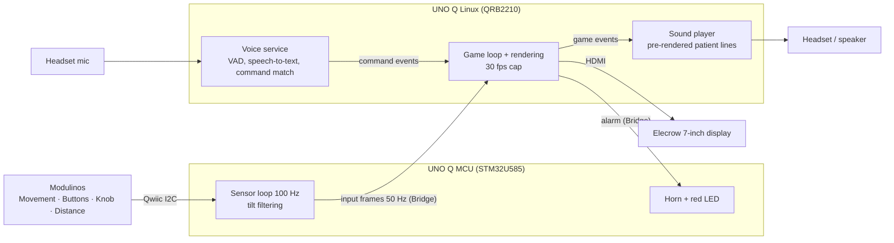

# Plan: Steady Hands (working title)

Draft of 13 November 2026, from our team discussion. ✅ marks a decision; ❓ marks a question still open. Wiring is in [WIRING.md](WIRING.md).

## The idea in one sentence

A working prototype of a surgeon trainer: you guide a surgical instrument through a patient map on a 7-inch screen by tilting the instrument in your hand, and you call for instruments by voice, as in a real operating room. The trainer measures how steady and precise you are. Everything runs offline on the Arduino UNO Q.

> The trainer is inspired by the steady-hand game Dr. Bibber (in English: Operation). We use our own name, patient, and artwork, so we can publish the build and demo it publicly.

## Why it is worth building

- **It trains what surgery needs:** steady hands, knowing the instrument names, and calling for instruments clearly while both hands are busy.
- **It trains the team, not just the hands.** In co-op mode, the surgeon calls for an instrument and the assistant repeats it back before the instrument is handed over. Operating-room teams confirm instructions out loud the same way (closed-loop communication), so the two only succeed if they talk to each other.
- **It gives measurable feedback.** After each round, the trainer shows time, wall contacts, steadiness, and instrument calls, so trainees can see their progress (see [Training feedback](#training-feedback)).
- **It is cheap, offline, and private.** It uses off-the-shelf parts and needs no internet or cloud, and it stores no audio. Training centres and medical schools with small budgets or poor connectivity can build and use it.
- **It is energy-aware.** Speech recognition runs only while a round is in progress and someone is speaking, and we measure the energy used (see [Energy and environment](#energy-and-environment)).
- ✅ **Target group:** medical students and operating-room trainees. This is a prototype, and we claim no proven training effect.

**Pitch sentence**, using the template from the hackathon README:

> For **medical students preparing for the operating room**, we help them **train steady hands and clear instrument calls** through speech, because **in surgery both hands are busy and instruments are requested by voice**, while keeping **their voices on the device**.

## Decisions

| Topic | Decision |
| --- | --- |
| ✅ Language | English |
| ✅ Players | One-player surgeon mode; two-player co-op as an extra mode |
| ✅ Listening | The mic listens all the time while a round runs, and is off in menus and idle |
| ✅ Where speech runs | On the UNO Q's Linux side; the Nicla Voice is dropped |
| ✅ Audio | Headset |
| ✅ Display | Elecrow 7" IPS, HDMI, 1024×600 |
| ✅ Energy measurement | PeakTech digital multimeter (see [WIRING.md](WIRING.md#energy-measurement-with-the-peaktech)) |
| ❓ D1 Toolchain | App Lab app, or PlatformIO sketch plus standalone Python (see [D1](#d1-toolchain)) |
| ❓ D2 Speech-to-text | Whistle or Vosk, chosen after the M0 test (see [Speech pipeline](#speech-pipeline)) |
| ✅ Purpose | Working prototype of a surgeon trainer, inspired by Dr. Bibber |
| ❓ D3 Name | "Steady Hands" is a placeholder |
| ❓ D4 Audio for the audience | Headset audio only reaches the person wearing it. Does the display have an audio jack, or can we get a USB speaker? |
| ❓ D5 License for our code | Must fit the licenses of the models we use (see [Licenses](#licenses)) |

## Gameplay

### One-player mode

The surgeon holds the **instrument**, a handle containing the Modulino Movement, and tilts it to steer the tool tip through the corridors of the patient map. The surgeon wears the headset and calls for tools. Touching a wall sounds the horn, flashes the red LED, makes the patient react ("Ouch!"), and raises the patient's heart rate. After three touches, the patient wakes up and the round is lost. Removing every item before time runs out wins.

### Co-op mode (two players)

- The **surgeon** steers and calls for instruments out loud ("Clamp!").
- The **assistant** wears the headset and repeats each call back ("Clamp."). The game hands the instrument over when it hears the call-back. Operating-room teams use this closed-loop confirmation too.
- The assistant also runs the room by voice: switching on the light, and calling "steady" for precision mode.

### Controls

| Input | Action |
| --- | --- |
| Modulino Movement (in the instrument) | Tilt moves the tool tip |
| Modulino Knob | Steering sensitivity; scrolls in menus |
| Modulino Buttons A / B / C | A: grab or release · B: pause/menu (long press cycles tools as a voice fallback) · C: switch between one-player and co-op |
| Modulino Distance (optional, stretch) | Hand height sets depth: lower your hand to grab, raise it to travel |
| Voice | Tool and room commands (see below) |

### Voice commands

We picked words that sound different from each other. Every recognised command is shown on screen so the player sees what the game heard.

| Command | Effect |
| --- | --- |
| `forceps` | Grab tool: picks up items |
| `swab` | Clears blood that blocks a corridor |
| `clamp` | Stops a bleeding timer |
| `scalpel` | Opens a sealed passage (stretch) |
| `light` | Lights up a dark part of the map for a few seconds (co-op) |
| `steady` | Precision mode for a few seconds: slower, finer movement |
| `cancel` | Undoes the last tool change, or closes the menu |
| `repeat` | The patient repeats their last line |
| `help` | The patient lists the commands that work right now |
| `pause` · `continue` · `new game` | Game flow |

### Levels

Each level is a PNG mask with a small JSON file:
- the mask has black walls, white corridors, and coloured item spots,
- the JSON holds the start point, the items, and the tool each item needs.

Collision detection is a pixel lookup in the mask, so anyone on the team can draw levels. Target: three levels for the demo.

### Training feedback

After each round, the screen shows:

| Metric | How we measure it |
| --- | --- |
| Time | From the start of the round until the last item is out |
| Wall contacts | Number of collisions |
| Steadiness | Jitter in the filtered tilt signal while moving through corridors |
| Instrument calls | Correct calls, and calls for the wrong instrument for the task |
| Precision help | How often `steady` was used |

Levels get harder step by step, with narrower corridors and less time. Results are kept as numbers for the current session only. No audio and no personal data are stored.

## Architecture



The MCU does the timing-critical input and output. Linux runs the game, the display, and speech. Because the display is HDMI, rendering has to happen on Linux.

### Interfaces (agree on these first so we can work in parallel)

MCU and Linux, over the Bridge:

| Direction | Message | Content |
| --- | --- | --- |
| MCU → Linux | `input` (50 Hz) | `tilt_x`, `tilt_y` (filtered), `knob`, `buttons` (bit mask), `distance_mm` |
| Linux → MCU | `alarm` | Duration in ms: horn and red LED on together |
| Linux → MCU | `leds` | Button LED mask, used to show the active tool |
| Linux → MCU | `voice_state` | `off`, `listening`, `processing`, or `speaking`, shown on the UNO Q's on-board RGB LED 4 (no wiring needed) |

Inside Linux, between the voice service and the game:

| Direction | Event | Content |
| --- | --- | --- |
| Voice → game | `command` | Command word and confidence |
| Game → voice | `listen` | `on`/`off`: listening runs only during a round |
| Game → sound | `event` | `hit`, `item_out`, `win`, `lose`, `help`, ... → plays the matching patient line |

### D1 Toolchain

The workshop slides changed the picture. The organisers' speech examples (Whistle speech-to-text, "Hey Arduino" keyword spotting) and the Python side of the Bridge are **App Lab apps**. When an App Lab app starts, App Lab compiles and flashes **its own** sketch. That would overwrite a sketch flashed with PlatformIO.

| | Option A: App Lab app | Option B: PlatformIO + standalone Python |
| --- | --- | --- |
| MCU sketch | `sketch/` in the app, built by App Lab | `firmware/` (already builds and flashes) |
| Linux side | Python app in App Lab's container; Bridge library included | Our own Python environment; we write a client for the Bridge socket |
| Organiser examples | Usable directly | Have to be ported |
| Help from mentors | Yes | Hardly; the platform is unofficial |
| Workflow | Edit in VS Code, deploy with `arduino-app-cli` over adb (script to be written) | `firmware/tools/board.sh` |

**Recommendation:** Option A. It is the official path, the examples work in it as they are, and the Arduino mentors at the event can help. The architecture and interfaces above stay the same either way. ❓ Decide at the start of M0.

## Speech pipeline

1. **Mic:** headset, 16 kHz mono, read only while a round runs.
2. **Gate:** voice activity detection (Silero VAD or WebRTC VAD). Speech-to-text runs only on detected speech segments.
3. **Speech-to-text (❓ D2):** we test both options in M0 on 20 spoken commands with real hall noise, then pick one.
   - **Whistle** (Cactus Compute; 16.9 MB model; 7 languages). The workshop shows it running on the UNO Q's Linux side, and the slides link the project. It transcribes freely, and we match the text against the command list.
   - **Vosk small English** with its vocabulary restricted to our commands. Restricting the vocabulary makes recognition more robust, and the model is small.
4. **Response:** every recognised command appears on screen. Target: under 1 s from the end of a word to the tool change (to be measured).
5. **Text-to-speech:** Piper with an English voice. We render all patient lines to WAV once at setup, so the game only plays files and there is no speech synthesis during play.
6. **Privacy:** audio exists only in memory. It is never written to disk and never sent anywhere.

No LLM: the patient's lines are scripted. This saves the most energy and keeps response times short.

### Speech interaction

**Visible states.** Players always see what the voice system is doing, on screen as a microphone icon and on the UNO Q's on-board RGB LED 4:

| State | Screen | LED 4 |
| --- | --- | --- |
| Off (menu, idle) | Grey microphone | Off |
| Listening | Green microphone, pulsing | Green |
| Processing (speech detected, recognising) | Yellow microphone | Yellow |
| Speaking (patient line playing) | Speech bubble from the patient | Blue |

**No listening while the patient speaks.** During a patient line the mic input is ignored, so the game never reacts to its own voice.

**Misheard speech:**
- A match below the confidence threshold triggers nothing. The screen shows "?" and the patient asks "Pardon?".
- After two misses in a row, the patient lists the commands that fit the current situation, as with `help`.
- Speech that doesn't resemble any command is ignored silently. This matters most in co-op, where the players talk to each other all the time and the game must not interrupt them.
- `cancel` undoes a wrongly recognised tool change.

**Response time.** The README asks for a reply within 3–5 s. Our target is stricter: under 1 s for commands, and patient lines start without delay because they are pre-rendered. We measure both in M0.

### Memory budget

The 4 GB RAM is shared by Debian, the desktop, the game, and speech. We measure with `free -m` in M0 and keep **at least 1 GB free**.

| Part | Expected memory | Source |
| --- | --- | --- |
| Debian + desktop | Measure | |
| Speech-to-text: Whistle | 16.9 MB model file; memory at runtime unknown, so measure | Model card |
| Speech-to-text: Vosk small | Around 300 MB | Hackathon README, model catalogue |
| Piper | Runs only at setup, to pre-render the patient lines; not loaded during play | |
| VAD | Small; measure | |
| Game (pygame) | Measure | |

Leaving out an LLM saves the most: the README estimates about 1 GB of RAM for a 1B model.

## Energy and environment

**What we do:**
- Speech-to-text runs only during a round, and only when VAD detects speech.
- A fixed command list allows a small model.
- Patient lines are pre-rendered; there is no text-to-speech during play.
- Rendering is capped at 30 fps. The map is pre-rendered, so only the moving parts are redrawn.
- The MCU filters the sensors and sends 50 frames per second, so Linux does not poll.
- **Idle mode:** after 60 s without input, the display goes to standby and the mic is off. A button press wakes everything up.
- **Build:** we make the case and the instrument from cardboard and leftover material, use no batteries, and publish everything as open source.

**What we measure** (method in [WIRING.md](WIRING.md#energy-measurement-with-the-peaktech)):
- Power in four states: idle, menu, round without speech, round with speech.
- Energy per round in Wh.
- The saving from VAD, compared with running speech-to-text all the time.
- CPU use per state, as a software measure that does not need the multimeter.

We show the measured values in the demo. Only measured numbers go into the pitch.

## Licenses

The event encourages publishing the build as open source. Before we publish, we check every component's license. Models and voices often have licenses of their own, separate from their code.

| Component | License | Status |
| --- | --- | --- |
| PlatformIO platform `lee-lab-skku/arduinoq` | Apache-2.0 | ✅ from its README |
| Whistle model | ❓ | Check the model card |
| Vosk model (English, small) | ❓ | Check the model catalogue |
| Piper (engine) and the chosen voice | ❓ | Check the engine repo and the voice's model card separately |
| Silero VAD | ❓ | Check the repo |
| `Arduino_Modulino`, Arduino core | ❓ | Check the repos |
| Our code (D5) | ❓ | Proposal: MIT or Apache-2.0, if the model licenses allow it |

Models are never committed to the repo (see `.gitignore`). The setup scripts download them, so the repo only needs a license for our own code.

## Work split

| Person | Area | Done when |
| --- | --- | --- |
| 1 | **Voice**: headset audio, VAD, speech-to-text, command matching, pre-rendered patient lines | Spoken commands arrive as `command` events with the measured response time |
| 2 | **Game and display**: game loop, levels, collision, on-screen display (heart rate, tool, time), modes | Three levels playable with keyboard controls before the hardware is ready |
| 3 | **Hardware and MCU**: Modulino chain, sketch, horn and LED, instrument handle, case | `input` frames arrive at 50 Hz; `alarm` works |
| 4 | **Integration, energy, pitch**: Bridge interfaces, start scripts, idle mode, measurements, demo script | Single-command start; measured values in the README; two-minute demo rehearsed |

## Milestones

Event end: 14 November, 12:00. The exact build cutoff is not published; ask the organisers.

| Milestone | Target | Done when |
| --- | --- | --- |
| **M0 Risk tests** | 13 Nov, about 15:00 | Each person has proven their riskiest part on the real board: a spoken word is recognised from the headset; tilt values arrive on Linux; a window appears full-screen on the Elecrow; the horn and LED switch. D1 and D2 decided. |
| **M1 First playable** | 13 Nov, about 20:00 | One-player mode works for one level: tilt steers, a wall touch sounds the horn and lights the LED, and one voice command changes the tool |
| **M2 Feature complete** | 14 Nov, about 03:00 | All commands including `cancel`; voice states visible on screen and LED; "Pardon?" for misheard speech; patient lines; three levels; co-op; idle mode |
| **M3 Demo ready** | 14 Nov, about 09:00 | Measured values in hand; polish done; demo script rehearsed. After that, only bug fixes. |

## Risks and fallbacks

| Risk | Fallback |
| --- | --- |
| Speech recognition unreliable in hall noise | Headset mic close to the mouth; restricted vocabulary (Vosk); every command visible on screen; button fallback for tools |
| Bridge or Modulino library does not work with PlatformIO (Option B) | Switch to Option A |
| Python rendering too slow on the board | Lower resolution or fps; redraw only the parts that change |
| Hub cannot power the display and headset | Separate 5 V USB charger for the display |
| Horn needs more than 5 V or too much current | Driver with a MOSFET, or replace it with a 5 V buzzer (see [WIRING.md](WIRING.md#horn)) |
| Not enough time | Cut in this order: distance sensor, scalpel, co-op extras. One-player mode with three tools is the minimum version. |

## Hackathon criteria check

The requirements come from the hackathon README: the event constraints plus our own proposed team requirements.

| Requirement | How we meet it | Where |
| --- | --- | --- |
| Builds on the UNO Q | Game, speech, and sensors all run on the UNO Q | [Architecture](#architecture) |
| Voice processed locally; no audio stored or sent to the cloud | Audio exists only in memory; no network needed during play | [Speech pipeline](#speech-pipeline) |
| Energy-aware inference, measured | VAD gating, pre-rendered patient lines, idle mode, no LLM; measured per state | [Energy and environment](#energy-and-environment) |
| Open source, published | Code and docs public; model licenses checked | [Licenses](#licenses) |
| Speech helps the user (hands or eyes busy) | Both hands steer, so instruments are called by voice, as in a real operating room | [Why it is worth building](#why-it-is-worth-building) |
| One specific user group and situation | Medical students and operating-room trainees, training steady hands and instrument calls | [Why it is worth building](#why-it-is-worth-building) |
| Clear benefit, visible quickly | Feedback after every round: time, wall contacts, steadiness | [Training feedback](#training-feedback) |
| Help, repeat, cancel | Voice commands `help`, `repeat`, `cancel` | [Voice commands](#voice-commands) |
| Visible listening, processing, and speaking states | Microphone icon on screen and on-board RGB LED 4 | [Speech interaction](#speech-interaction) |
| Recovery from misheard speech | Confidence threshold, "Pardon?", list of fitting commands, `cancel`, button fallback | [Speech interaction](#speech-interaction) |
| Response within 3–5 s | Target under 1 s for commands; measured in M0 | [Speech interaction](#speech-interaction) |
| Fits in 4 GB RAM | Memory budget with at least 1 GB free | [Memory budget](#memory-budget) |
| Minimum version without an unrestricted LLM | No LLM at all; patient lines are scripted | [Speech pipeline](#speech-pipeline) |
| Four parallel work areas with clear interfaces | Work split plus interface tables | [Work split](#work-split), [Interfaces](#interfaces-agree-on-these-first-so-we-can-work-in-parallel) |
| Demo of the value in two minutes | Demo script in M3 | [Milestones](#milestones) |

## Questions for the organisers

- Judging criteria and their weights; exact build cutoff; demo format and length.
- Is a particular license required for the published build?
- Can we borrow a USB-C power meter? A multimeter alone cannot easily measure the whole setup (see [WIRING.md](WIRING.md#energy-measurement-with-the-peaktech)).
- Is training in the cloud (for example Edge Impulse) allowed during development, given that no voice data may leave the device during use?

## Planned repo layout

```
firmware/   MCU sketch (PlatformIO, exists) or sketch/ for App Lab (D1)
game/       Game loop, rendering, modes (Python, Linux side)
voice/      VAD, speech-to-text, command matching, sound player
levels/     Level masks (PNG) + JSON
docs/       Measured values, demo script, pitch
```

## References

- Workshop slides "Hands-On with Arduino UNO Q", 13 November 2026 (the local PDF in the old hackathon folder)
- [UNO Q datasheet](https://docs.arduino.cc/resources/datasheets/ABX00162-ABX00173-datasheet.pdf) · [UNO Q documentation](https://docs.arduino.cc/hardware/uno-q/)
- [Arduino_Modulino examples](https://github.com/arduino-libraries/Arduino_Modulino/tree/main/examples) (version 0.10.0 in the workshop)
- [Cactus Whistle](https://huggingface.co/Cactus-Compute/whistle) · [Vosk models](https://alphacephei.com/vosk/models) · [Piper](https://github.com/OHF-Voice/piper1-gpl) · [Silero VAD](https://github.com/snakers4/silero-vad)
- [Elecrow 7" IPS (wiki)](https://elecrow.com/wiki/7inch_IPS_HD_Touch_Screen-D.html)
