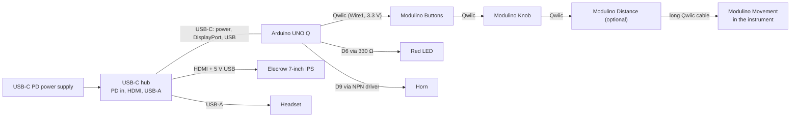
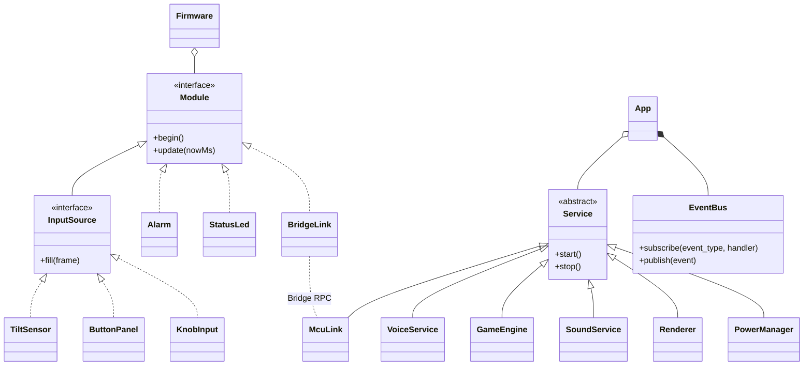

# Steady Hands (working title)

A working prototype of a voice-controlled surgeon trainer on the Arduino UNO Q, inspired by the steady-hand game Dr. Bibber. Built by team PromptPimps at the Speech-to-Speech hackathon (13–14 November 2026, Nürnberg).

You guide a surgical instrument through a patient map on a 7-inch screen by tilting the instrument in your hand. You call for instruments by voice ("forceps!", "clamp!"), as in a real operating room, and touching a wall sounds the horn. After each round, the trainer shows your time, wall contacts, and steadiness. In co-op mode, the assistant repeats every call back before the instrument is handed over, the way operating-room teams confirm instructions. Speech recognition, game logic, and speech output run entirely offline on the board, and no audio is stored.

## Documents

| Document | Contents |
| --- | --- |
| [PLAN.md](PLAN.md) | Idea, decisions, architecture, interfaces, work split, milestones, risks |
| [WIRING.md](WIRING.md) | Parts list, wiring, pin assignment, power, energy measurement |
| [firmware/README.md](firmware/README.md) | MCU sketch with PlatformIO: build, flash, one-time setup on each board |

## Hardware

- **Arduino UNO Q:** Linux (QRB2210) for the game, display, and speech; MCU (STM32U585) for sensors, horn, and LED
- **Display:** Elecrow 7" IPS over HDMI, through a USB-C hub
- **Modulinos:** Movement (tilt), Buttons, Knob, optionally Distance, chained over Qwiic
- **Audio:** headset
- **Signals:** horn and red LED

## Hardware wiring



Pin-level diagram, circuits, power, and measurement: [WIRING.md](WIRING.md).

## Code structure (UML)

All code is object-oriented and modular. On the MCU, every hardware part is a `Module`. On Linux, every feature is a `Service` that communicates over the `EventBus`. `BridgeLink` (MCU) and `McuLink` (Linux) connect the two sides.



Full class diagrams, design rules, and how to add a feature: [PLAN.md](PLAN.md#code-design).

## Status

Planning (13 November). Decided: a surgeon-training prototype for medical students; English; one-player mode with optional co-op; mic listening during play.

**Definition of done:** the project is finished only when every hackathon criterion in the [criteria check](PLAN.md#hackathon-criteria-check) is verified on the real board. Still open: toolchain (D1) and speech-to-text engine (D2); see [PLAN.md](PLAN.md#decisions).

The MCU toolchain works: the starter sketch builds and flashes with PlatformIO on the board.

```sh
cd firmware
tools/board.sh upload    # build and flash over USB
tools/board.sh monitor   # Serial output
```

## Working together

- `main` should always build. Work on short-lived branches per area (`voice/...`, `game/...`, `hw/...`, `docs/...`) and merge often.
- All code is object-oriented and modular. New features are new classes behind the existing interfaces; see [Adding a feature](PLAN.md#adding-a-feature).
- Never commit audio recordings or downloaded models. `.gitignore` excludes `models/`, `recordings/`, and build output; the setup scripts download models.
