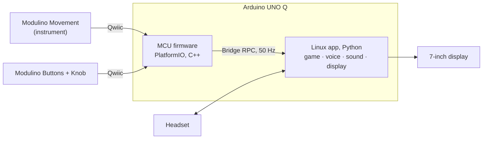

# Steady Hands

A voice-controlled surgeon trainer that runs entirely offline on an Arduino UNO Q. Built by team PromptPimps at the Speech-to-Speech hackathon (13–14 November 2026, Nürnberg), for medical students and operating-room trainees.

You steer a surgical instrument through a wound on a 7-inch screen by tilting it in your hand. Both hands are busy, so everything else is done by voice: you call for instruments like in a real operating room, and you give the anaesthesia nurse orders with a dose while the patient's vital signs go wrong. Speech recognition, game logic and speech output run on the board. No audio leaves the device, and none is stored.

## A round

- **Steer** the instrument (a handle with a Modulino Movement inside) through the corridors. Touching a wall buzzes, the patient cries out, and the pulse goes up. Three touches and the patient wakes up.
- **Call instruments** by voice: "Forceps!", "Clamp!", "Swab!", "Scalpel!". Remove the splinter, clamp the bleeding, swab the blood before the time runs out. `steady`, `light`, `cancel`, `repeat`, `help`, `pause` work too.
- **Watch the monitor** (from level 2 on): oxygen saturation, depth of anaesthesia (BIS) and blood pressure. When one goes wrong, the nurse raises the alarm. Order a drug and an amount: "Propofol 40.", "Oxygen to 60 percent.", "Push 10 micrograms of adrenaline." Each tile shows a dose card ("10 mg: −6"), so the monitor tells you the dose:
  - too little helps only part of the way ("BIS still at 63, doctor"), so you give more;
  - too much overshoots into the opposite alarm;
  - the wrong drug only brings its side effects.

  The nurse reads every order back, the way OR teams close the loop.
- **Co-op mode:** the surgeon calls, the assistant picks the instrument with the knob and hands it over with a button. Only the called one counts.
- **Feedback** after each round, on screen and spoken: time, wall contacts, steadiness of the hand, orders right, overdoses, crises.

## Speech

| What you say | How it is heard | Model |
| --- | --- | --- |
| Commands ("Clamp!", "pause") | Vosk, restricted to the command phrases | Vosk small English (40 MB) |
| Orders with a dose ("Propofol 40 and oxygen to 70") | Whistle transcribes the sentence; Needle reads drug and amount as a tool call (`set_oxygen(percent)`, `give_propofol(milligrams)`, `give_adrenaline(micrograms)`) | [Cactus](https://cactuscompute.com) Whistle (17 MB) and Needle 3, 12-layer rung (39 MB) |
| Spoken lines of the patient and the nurse | Pre-rendered once at setup, two voices | Piper |

- The two speech paths never fire each other's words.
- An order has to name the drug. Talk without a drug name never becomes an order.
- An amount the model invents is dropped: the runtime checks every number against the sentence.
- A drug named without an amount gets a standard dose, which fits only about half of the time.
- Without the Cactus models, the game still works by voice: drugs by name at the standard dose, no amounts.

**Measured on the board** (14 Nov): Needle reads 40 of 42 test orders right, with no false order from 14 sentences of talk, in about 1.9 s per order. Short commands are decided in under 0.1 s. The full app with both models leaves 1.9 GB of the 3.7 GB RAM free. Details: [docs/needle-integration.md](docs/needle-integration.md), [docs/measurements.md](docs/measurements.md).

## Hardware

Arduino UNO Q (Linux side: game, display, speech; MCU side: sensors, status LED) · Elecrow 7" display over HDMI · USB headset · Modulino Movement, Buttons and Knob over Qwiic · USB-C hub with power supply. Wiring: [WIRING.md](WIRING.md).



Every part is a class behind a small interface: a `Module` on the MCU, a `Service` on an `EventBus` in the app. Design and class diagrams: [PLAN.md](PLAN.md#code-design).

## Quick start

```sh
cd firmware && tools/board.sh upload           # build and flash the MCU (runs PlatformIO on the board)
app/tools/sync_to_board.sh                     # copy app/ and levels/ to the board
app/setup/board_setup.sh                       # on the board, once: packages, models, spoken clips
app/run.sh                                     # on the board: start the trainer
app/run.sh --config cactus.toml                # ... with Whistle + Needle (orders with doses)
cd app && python -m pytest                     # tests, on any computer
cd app && python -m trainer --windowed --no-mcu   # play on a laptop with the keyboard
```

Setting up Whistle and Needle (package, engine, building the rung): [docs/needle-integration.md](docs/needle-integration.md#switching-it-on).

## Repository

| Path | Contents |
| --- | --- |
| [firmware/](firmware/README.md) | MCU sketch: sensor modules, status LED, Bridge link |
| [app/](app/README.md) | Linux app: game engine, vitals monitor, voice pipeline, sound, UI, tools, tests |
| [levels/](levels/README.md) | Six levels: a PNG mask plus a JSON file each |
| [PLAN.md](PLAN.md) | Idea, gameplay, architecture, speech pipeline, energy, hackathon criteria check |
| [docs/](docs/README.md) | Measurements, test runs, the Cactus integration, board cheat sheet |

## Status

Hackathon prototype. Every feature above runs on the board. The hackathon criteria and the evidence for each are tracked in the [criteria check](PLAN.md#hackathon-criteria-check). Some rows are still open, among them real-speaker tests of the spoken orders and the energy measurements. The licence for our code is not decided yet (PLAN.md, D5).
