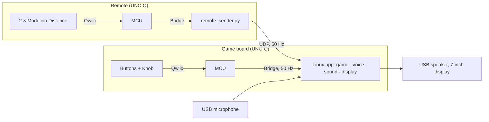

# Steady Hands

A surgeon trainer you steer by hand and talk to, fully offline on the Arduino UNO Q. Built by team Steady Hands at the Speech-to-Speech hackathon (13–14 November 2026, Nürnberg), for medical students in the skills lab.

You move a hand-held remote inside a small frame. Two laser distance sensors measure how far it is from two walls, and the instrument on the 7-inch screen follows. Both hands are busy, so everything else is done by voice: you call for instruments, and you give the anaesthesia nurse orders with a dose while the vital signs go wrong. No audio leaves the board, and none is stored.

## Hackathon deliverables

The deliverables named in the [Speech-to-Speech hackathon brief](https://github.com/th-nuernberg/speech-to-speech#expected-deliverables), and where to find each:

| Deliverable | Where |
| --- | --- |
| Working prototype, with at least one Modulino | Two UNO Q boards with four Modulinos (Buttons, Knob, 2 × Distance): [Hardware](#hardware). One round on video: [pitch/media/demo.mp4](pitch/media/demo.mp4) |
| Source code repository | This repo: [firmware/](firmware/README.md), [app/](app/README.md), [levels/](levels/README.md), under the [MIT licence](LICENSE) |
| Short technical documentation | [docs/technical-documentation.md](docs/technical-documentation.md) |
| Project on the Arduino Project Hub | Page text, ready to paste: [docs/project-hub.md](docs/project-hub.md) |
| 5-minute demo presentation | [pitch/](pitch/README.md): slides (`index.html`, [PDF](pitch/steady-hands-pitch.pdf)) and the 45 s demo video |
| Future roadmap | [ROADMAP.md](ROADMAP.md) |

How the project answers the judging criteria (20 % each):

| Criterion | Where to look |
| --- | --- |
| Innovation | A tool-calling model reads drug *and dose* from free speech, on the board; steering by two distance sensors with a freeze key instead of a joystick |
| Technical quality | One class per feature behind small interfaces ([PLAN.md](PLAN.md#code-design)), 174 app tests plus firmware unit tests, every number measured on the board ([docs/measurements.md](docs/measurements.md)) |
| Real-world impact | Skills-lab training for medical students: steady hand, instrument calls and dosed orders at once; offline, so it fits hospital data-protection rules |
| Environmental impact (SCI) | No general LLM, models gated by voice activity, smallest Needle rung, pre-rendered voices; SCI method in the [technical documentation](docs/technical-documentation.md#environmental-impact-sci) (power not measured yet) |
| Presentation and demo | [pitch/](pitch/README.md), 5 minutes with the live round on video |

## A round

- **Steer:** only how far the hand *travels* counts, so the frame never has to line up with the screen. Hold a button on the remote to freeze the instrument and bring the hand back, like lifting a mouse. A wall touch buzzes and raises the pulse; three touches and the patient wakes up.
- **Call:** "Forceps!", "Clamp!", "Swab!", "Scalpel!" to pull splinters, clamp bleeding and swab blood before the clock runs out. Also `light`, `steady`, `cancel`, `repeat`, `help`, `pause`.
- **Order** (from level 2): oxygen saturation, depth of anaesthesia (BIS) and blood pressure drift. The nurse raises the alarm; you order a drug and an amount ("Propofol 40.") and she reads it back. Each tile shows a dose card: too little helps only part of the way, too much overshoots into the opposite alarm.
- **Co-op:** the assistant picks the called instrument with the knob and hands it over by pressing it.
- **Feedback** after each round, on screen and spoken: time, wall contacts, steadiness, orders right. Six levels.

## Speech

| What you say | Heard by | Model on the board |
| --- | --- | --- |
| Commands ("Clamp!") | Vosk, limited to the command phrases | Vosk small English |
| Orders with a dose ("Propofol 40 and oxygen to 70") | Whistle transcribes, Needle reads drug and amount as a tool call (`give_propofol(milligrams)`, …) | [Cactus](https://cactuscompute.com) Whistle, Needle 3 cut to 12 layers |
| Patient and nurse | Pre-rendered once at setup | Piper, two voices |

The two paths never fire each other's words. An order needs a drug name, and an amount the model invents is dropped. Without the Cactus models the game still runs, with standard doses.

**Measured on the board** (14 Nov): at most 1.4 GB of the 3.7 GB RAM in use while playing; the three models take 127 MB on disk. Commands are decided in under 0.1 s, an order in about 1.9 s. Needle reads 40 of 42 test orders right and makes no order out of 14 sentences of talk. Details: [docs/measurements.md](docs/measurements.md), [docs/needle-integration.md](docs/needle-integration.md).

## Hardware

Two Arduino UNO Q boards. The **game board** runs game, display, microphone, speaker, and carries the Modulino Buttons and Knob. The **remote** carries two Modulino Distance sensors and only measures and sends. Both run the same firmware source, told apart by one build flag. Wiring: [WIRING.md](WIRING.md).



Every part is a class behind a small interface (`Module` on the MCU, `Service` on an `EventBus` in the app): [PLAN.md](PLAN.md#code-design).

## Quick start

```sh
cd firmware && tools/board.sh upload              # flash the game board's MCU
app/tools/sync_to_board.sh                        # copy app/ and levels/ to the board
app/setup/board_setup.sh                          # on the board, once: packages, models, voices
app/run.sh                                        # on the board: start the trainer
app/run.sh --config cactus.toml                   # ... with Whistle + Needle (orders with doses)
cd app && python -m trainer --windowed --no-mcu   # on a laptop, with the keyboard
cd app && python -m pytest                        # tests
```

Remote: `PLATFORMIO_BUILD_FLAGS=-DSH_CONTROL_MODE=2 tools/board.sh upload`, then `BOARD_SSH=arduino@<remote> GAME_HOST=<game board> app/tools/install_remote_sender.sh`. The game board then needs `remote.enabled = true` and `game.input_mode = "position"`, as in `app/debug-asr.toml`. Setting up Whistle and Needle: [docs/needle-integration.md](docs/needle-integration.md#switching-it-on).

## Repository

| Path | Contents |
| --- | --- |
| [firmware/](firmware/README.md) | MCU sketch: sensor modules, Bridge link |
| [app/](app/README.md) | Linux app: game, vitals monitor, voice, sound, UI, tests |
| [levels/](levels/README.md) | Six levels, a PNG mask and a JSON file each |
| [pitch/](pitch/README.md) | Pitch slides and demo video |
| [docs/](docs/README.md) | Technical documentation, measurements, test runs, Cactus integration, Project Hub text |
| [PLAN.md](PLAN.md) | Idea, architecture, speech pipeline, criteria check |
| [ROADMAP.md](ROADMAP.md) | What comes after the hackathon |
| [WIRING.md](WIRING.md) | Wiring, power, energy measurement |
| [increment1/](increment1/README.md) | First speech-to-speech prototype from day one, superseded by `app/` |

## Status

Hackathon prototype; every feature above runs on the board. Open: tests with real speakers and the energy measurements ([roadmap](ROADMAP.md)). Criteria and evidence: [criteria check](PLAN.md#hackathon-criteria-check).

## Licence

Our code is under the [MIT licence](LICENSE). The models (Vosk, Whistle, Needle, the Piper voices) are not in the repo; the setup script downloads them, and they keep their own licences ([PLAN.md](PLAN.md#licenses)).
