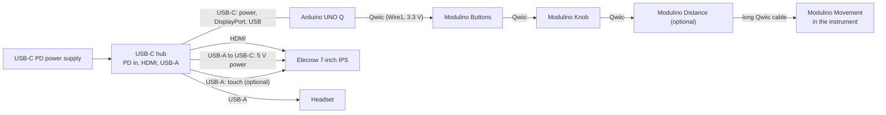

# Wiring plan

Draft of 13 November 2026. Check every item marked ⚠ before the first power-on. The architecture and interfaces are in [PLAN.md](PLAN.md).

## Parts list

| Part | Qty | Notes |
| --- | --- | --- |
| Arduino UNO Q | 1 | |
| USB-C hub with PD input, HDMI, and at least 2 × USB-A | 1 | From the organisers (workshop kit) |
| USB-C PD power supply | 1 | From the organisers; powers the hub, and the hub powers the board |
| Elecrow 7" IPS display + HDMI cable + USB cable | 1 | ⚠ Check the exact model on the back. These notes assume the "7inch IPS HD Touch Screen-D" variant (5 V over USB-C). |
| Headset | 1 | ⚠ USB or 3.5 mm jack? A jack headset needs a USB sound card. |
| Modulino Movement | 1 | Goes in the handheld instrument |
| Modulino Buttons | 1 | |
| Modulino Knob | 1 | |
| Modulino Distance | 0–1 | Optional (stretch) |
| Qwiic cables | 4 | One of them longer, about 30–50 cm, for the instrument |
| PeakTech multimeter + USB breakout (male/female) | 1 | For [energy measurement](#energy-measurement-with-the-peaktech) |

## Overview



## UNO Q pin assignment

| UNO Q connector | Goes to | Notes |
| --- | --- | --- |
| USB-C | Hub | The board's only USB port: power in, plus HDMI over DisplayPort Alt Mode, plus USB devices |
| Qwiic | Modulino chain | I2C bus `Wire1`, 3.3 V. Not `Wire`. |
| Header pins (D0–D21, 5V, GND) | Nothing | No wire goes to the headers |

Logic level is **3.3 V**. Do not connect any 5 V signal to an input. All sensors go through Qwiic at 3.3 V, so this only matters for extra wiring.

## Modulino chain (Qwiic)

```
UNO Q [Qwiic] ── Buttons ── Knob ── Distance (optional) ══ long cable ══ Movement (in the instrument)
```

- Every Modulino has two Qwiic ports, so they can be chained in any order. The long cable goes at the **end** of the chain, so the fixed modules stay close to the board.
- Different module types have different I2C addresses, so they can share the bus. Two modules of the **same** type need a different address; the library can change it.
- The bus runs at 400 kHz by default. If the long cable causes errors, set `Wire1.setClock(100000)` before `Modulino.begin()`.
- Library: `Arduino_Modulino` (the workshop uses 0.10.0).

## Display, touch, audio

- **Image:** hub HDMI to the Elecrow's HDMI input. The UNO Q outputs video over its USB-C port (DisplayPort Alt Mode) through the hub.
- ⚠ **Measured 13 Nov:** the panel announces **1920×1080** over EDID (not its native 1024×600) and downscales internally. The renderer still sets 1024×600; check text legibility from two metres.
- **Power:** 5 V over the display's USB-C, about 2.55 W according to the Elecrow wiki for the IPS-D variant. Take it from a hub USB-A port. If the image flickers or the hub drops out, use a separate 5 V USB charger.
- **Touch:** separate USB connection, optional. It could be used for menus.
- **Headset:** USB into the hub. A jack headset needs a USB sound card.
- ❓ **Audio for the audience:** some Elecrow variants have a 3.5 mm audio output (sound over HDMI), where a small speaker could connect. Check on the device.

## Power

- **A single supply:** PD power supply → hub → UNO Q. The UNO Q takes 5 V at up to 3 A over USB-C. The manual gives peaks of up to 2.5 A.
- Do not power the board from a laptop USB port while the hub, display, and headset are connected. Laptop ports often cannot deliver the peak current.
- Only wire with the power off. Plug Qwiic modules in only with the power off.

| Consumer | Value | Source |
| --- | --- | --- |
| UNO Q | Up to 2.5 A peak at 5 V | UNO Q manual |
| Elecrow 7" IPS-D | About 2.55 W | Elecrow wiki |
| Headset, Modulinos | Unknown | To be measured |

## Energy measurement with the PeakTech

A multimeter measures current only **in series**, so the circuit has to be broken.

**Setup:** put a USB breakout (male/female) in the 5 V line of the device you want to measure.
1. Multimeter on DC A. Red probe in the **10 A socket**, black in COM. Start with the 10 A range.
2. Interrupt VBUS (5 V) on the breakout and bridge the gap with the multimeter.
3. Then measure the voltage between VBUS and GND on the same breakout (V socket, DC V).
4. Power P = U × I. Energy per round = mean power × round time.

**What can be measured:**
- **Display alone:** in its USB power cable (5 V). This works with a USB-A breakout.
- **Board plus hub:** only on the hub input. It runs over USB-C PD, often at 9–20 V, which a simple breakout cannot interrupt. → Ask the organisers for a **USB-C power meter**.
- **Software measure (always possible):** log CPU use per state from `/proc/stat`. Together with one or two multimeter measurements, this gives a power estimate per state. It also shows the saving from VAD as a relative number.

**Safety:**
- Never hold the probes across 5 V and GND while the meter is in the current range. That is a short circuit and will blow the meter's fuse.
- After measuring current, move the red probe back to the V socket.

## Checklist before the first power-on

- [ ] Nothing connected to the header pins
- [ ] Display model and power supply checked
- [ ] Qwiic cables fully seated; long cable at the end of the chain
