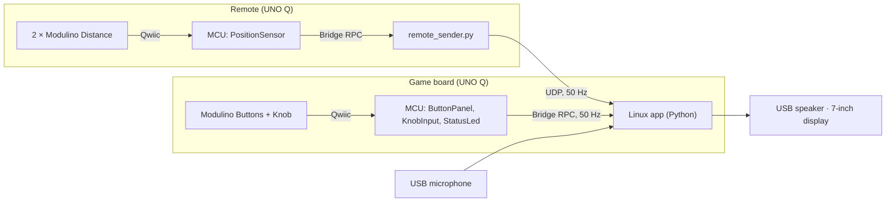
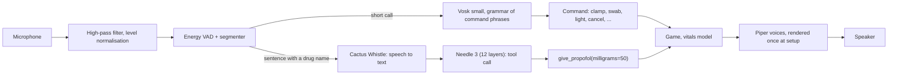

# Steady Hands: technical documentation

Steady Hands is a surgeon trainer for medical students. You steer an instrument through a wound on a 7-inch screen with a hand-held remote, call instruments by voice and give the anaesthesia nurse orders with a dose. Speech recognition, the tool-calling model, game and voices all run offline on Arduino UNO Q boards. No audio leaves the board, and none is stored.

This page is the short version. Details: [PLAN.md](../PLAN.md) (design and decisions), [WIRING.md](../WIRING.md) (wiring, power), [firmware/](../firmware/README.md), [app/](../app/README.md), [measurements.md](measurements.md).

## Hardware

| Part | Qty | Where | Role |
| --- | --- | --- | --- |
| Arduino UNO Q (4 GB) | 2 | Game board, remote | Linux (QRB2210) runs the app, the MCU (STM32U585, Zephyr) reads the Modulinos |
| Modulino Buttons | 1 | Game board | A uses the instrument, B pauses, C steps to the next instrument; LEDs show the active tool |
| Modulino Knob | 1 | Game board | Co-op: the assistant picks the called instrument and hands it over by pressing |
| Modulino Distance (time of flight) | 2 | Remote | Distance of the hand to the side wall and to the top wall |
| Freeze key | 1 | Remote | Any button or the knob press of a Modulino on the remote's chain; held, it freezes the instrument |
| Elecrow 7" IPS display, HDMI | 1 | Game board | Game screen |
| USB headset (microphone + speaker) | 1 | Game board | Speech in and out |
| USB-C hub with PD input, HDMI, USB-A, and a PD power supply | 1 | Game board | The UNO Q has a single USB-C port for power, video and USB |
| Qwiic cables | 4 | Both | Modulino chains on `Wire1`, 3.3 V; no header pins are needed |

Both distance sensors ship with the same I2C address. The remote's firmware moves whichever one it can reach to a free address, so the second can join afterwards; an optional wire to one sensor's XSHUT pad, or a Modulino Hub, does the same without the plug-in order (`PositionSensor` in [firmware/lib/](../firmware/lib/)).

## Architecture

- **Firmware** (C++, PlatformIO with the `lee-lab-skku/arduinoq` platform): one class per sensor behind a `Module` interface. Both boards build the same source; the build flag `SH_CONTROL_MODE=2` makes the remote. The MCU filters the sensors and pushes 50 frames per second, so Linux never polls. Host unit tests: `pio test -e native`.
- **Linux app** (Python 3.13, pygame): every feature is a `Service` on an `EventBus`. Events carry numbers and short identifiers only, never audio or transcripts. 174 pytest tests run headless on any computer (`cd app && python -m pytest`, all green on 14 Nov 2026).
- **Steering:** only the change in distance between two frames moves the instrument, so the frame never has to line up with the screen. Jumps larger than a set step are dropped as the laser finding another target. Holding the freeze key on the remote lets the hand return without moving the tool.

## Speech pipeline

| Stage | Model | Size on disk | Why |
| --- | --- | --- | --- |
| Commands | Vosk small English, restricted to our command phrases | 71 MB unpacked | A fixed grammar cannot hear "four steps" for "forceps", and decides in under 0.1 s |
| Orders: speech to text | [Cactus Whistle](https://huggingface.co/Cactus-Compute/whistle) | 17 MB | Free sentences with numbers |
| Orders: drug and amount | Needle 3, published weights cut to 12 of 20 layers, no fine-tuning | 39 MB | Three tools with an amount: `set_oxygen(percent)`, `give_propofol(milligrams)`, `give_adrenaline(micrograms)` |
| Patient and nurse | Piper, two voices | rendered clips | No speech synthesis during play |

Rules that keep the two paths apart:

- A sentence becomes an order only if it names a drug. Without a drug name, Needle does not run.
- An amount the model returns that is not in the sentence is dropped.
- A drug without an amount gets the standard dose, which fits about half of the time.
- Without the Cactus models (default config), every feature still works by voice, with standard doses.

The nurse reads every order back ("Propofol 50 milligrams."), like an operating-room team closing the loop. Each vital sign has a dose card on its tile ("10 mg: −6"); too little helps only part of the way, too much overshoots into the opposite alarm.

## Privacy and offline operation

- Audio exists only in memory, in the current segment. No audio file is written, and nothing is sent.
- Logs and metrics hold command identifiers and timings, never transcripts.
- No network service is needed during play; the Cactus runtime runs with `CACTUS_TELEMETRY=0`. The only network traffic is the remote's distance frames on the local network.
- Models are downloaded once by the setup script and never committed to the repo.

## Measured on the board

All numbers from [measurements.md](measurements.md), 13–14 November 2026, on the game board with the full app running.

| What | Value |
| --- | --- |
| RAM in use while playing (peak) | 1.4 GB of 3.7 GB |
| Speech models on disk (Vosk, Whistle, Needle) | 127 MB |
| Command, end of speech to decision | median 87 ms, worst 104 ms (32 cases, synthetic voices) |
| Order, Needle model call | median 1851 ms, worst 3615 ms |
| Orders read right (drug and amount) | 40 of 42 test orders |
| False orders from plain talk | 0 of 14 sentences |
| Needle worker memory | 115 MB peak |

The test sentences come from one author and the voice tests used synthetic voices. Tests with real speakers are the first step of the [roadmap](../ROADMAP.md).

## Environmental impact (SCI)

The judging uses the Green Software Foundation's [Software Carbon Intensity](https://sci.greensoftware.foundation/):

> SCI = (E × I + M) per R

| Term | For Steady Hands | Status |
| --- | --- | --- |
| R, functional unit | One training round of about 60 s, including the spoken feedback | Defined |
| E, energy per round | Mean power of game board, remote and display during a round × round time | ⬜ Not measured yet: needs a USB-C power meter on each hub input ([method](../WIRING.md#energy-measurement-with-the-peaktech)) |
| I, grid intensity | Location-based intensity of the German grid at the time of use | ⬜ To be filled in with the measurement |
| M, embodied emissions | Share of the two boards, display and hub, spread over their expected lifetime in rounds | ⬜ Needs the manufacturers' footprint data |

What already lowers E and M by design:

- **No general LLM.** A 1B LLM needs about 1 GB of RAM; our three speech models take 127 MB on disk, and the app peaks at 1.4 GB of RAM, so it fits the UNO Q instead of needing a PC or the cloud.
- **Models run only when needed.** Speech-to-text runs only when the VAD hears speech; Whistle only for sentences, never for short calls; Needle only for sentences that name a drug.
- **Smallest model that passes.** Needle is cut to 12 of its 20 layers: the smallest rung that reached our bar, without training runs.
- **No speech synthesis at run time.** All spoken lines are rendered once at setup.
- **Light rendering:** 30 fps cap, the map pre-rendered; the MCU pushes sensor frames instead of Linux polling.
- **Idle mode:** after 60 s without input the display goes to standby and the microphone off.

## Limitations

- Tested with synthetic voices only; real speakers and hall noise are still to be tested.
- Energy and therefore the SCI value are not measured yet.
- The licence of the Needle weights still has to be checked ([PLAN.md](../PLAN.md#licenses)).
- English only.
- Two boards: the remote is a whole UNO Q for two distance sensors.

## Build and run

See the [Quick start](../README.md#quick-start). In short: flash each MCU with `firmware/tools/board.sh upload` (the remote with `-DSH_CONTROL_MODE=2`), copy the app with `app/tools/sync_to_board.sh`, run `app/setup/board_setup.sh` once on the board, then `app/run.sh` (add `--config cactus.toml` for Whistle and Needle).
